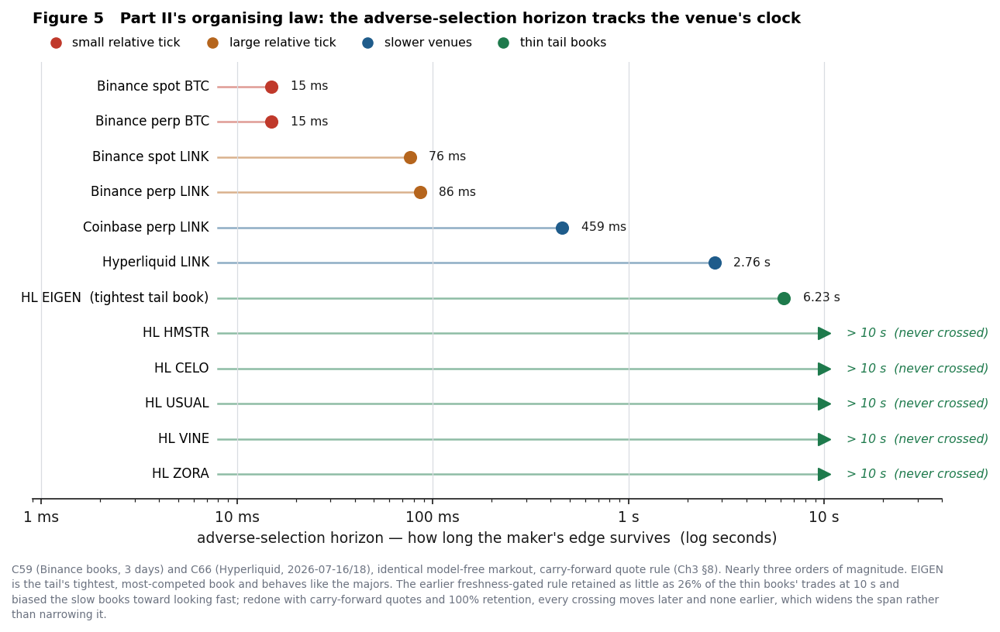
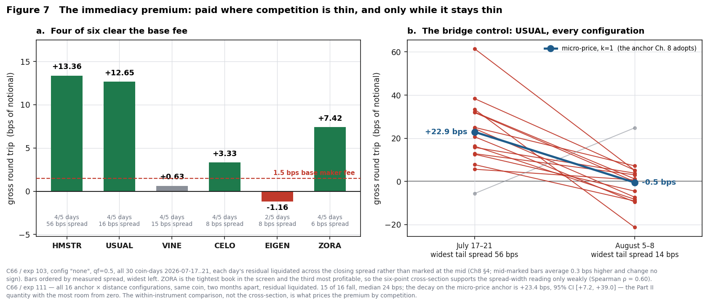

# The Immediacy Premium in Thin Books

---

## 1. Where the Zeros Were Measured

Every zero in Part I was measured on a densely-competed book. LINK and BTC on Binance,
Hyperliquid's majors, Coinbase's majors: all venues where thousands of participants quote and
the spread is compressed, tick by tick, to the cost it must cover. Chapter 6 §2 measured that
compression directly — the median spread is exactly one tick and it repairs itself in about
100 ms, faster than a retail participant can react.

But the compression is performed *by competitors*, and that observation is the opening this
chapter exploits. Grossman-Miller's account of liquidity provision predicts a premium wherever
entry is costly enough that few providers arrive: the immediate counterparty to an impatient
trader must be compensated for warehousing a position nobody else wants. Wyart-Bouchaud says
the spread tracks the adverse-selection cost; it does not say the spread *equals* it on a book
where nobody is competing the surplus away.

So the question is empirical and specific: does a book with two or three makers at the touch
sit *above* the equilibrium the majors sit on? Crypto's long tail is the natural place to look,
and it is the one regime this thesis had not sampled.

## 2. Finding the Thin Books

Contribution 66 begins with a screen rather than a hypothesis. All 232 Hyperliquid perpetuals
are ranked by spread × √volume within a volume band — wide enough to pay, liquid enough to
trade — and six candidates spanning 9 to 56 bps of spread were captured for five days.

The tail is a different world from anything measured so far:

| book | spread | volume/day | orders at touch |
|---|---|---|---|
| HMSTR | **56 bps** | $244k | 22 |
| CELO | 25 bps | $236k | **2** |
| USUAL | 23 bps | $186k | 11 |
| VINE | 19 bps | $394k | **3** |
| ZORA | 16 bps | $645k | **3** |
| EIGEN | 9 bps | $3.3M | 13 |

against HL_BTC's 0.15 bps and 39 orders at the touch. Two or three orders at the touch is thin
competition *observed* rather than inferred, and the processed data makes it quantitative:
**13 to 101 unique makers per day** on these books, against thousands on the majors.

One caveat on that table, which matters for §5. Those spreads are the *screening* snapshot that
selected the six coins; the median spread actually quoted during the five captured days differs,
in two cases substantially — CELO at 7.7 bps rather than 25, and ZORA at 6.2 rather than 16,
with HMSTR unchanged at 56. The two measures rank the books similarly (Spearman ρ = 0.77) but
not identically, and §5 relates the round trip to the *measured* spread, since that is the
quantity contemporaneous with the P&L it is being compared against. A 56 bps
spread against a 1.5 bps maker fee also means that, for the first time in this thesis, the fee
gate of Chapter 5 §4 is not the binding constraint.

## 3. The Adverse-Selection Horizon Is a Property of the Venue

The first test is the Chapter 6 §4 markout, unchanged, applied to the tail. On five of the six
books the maker's realized half-spread **never goes negative within ten seconds** — the
adverse-selection horizon runs off the end of the measurement window.

Set against the earlier measurements, a single ordering emerges:

| book | adverse-selection horizon | retention at 10 s, old rule |
|---|---|---|
| Binance BTC spot / perp (small relative tick) | **15 ms** | 97–100% |
| Binance / Hyperliquid LINK (large relative tick) | **75–88 ms** | 62–82% |
| Coinbase LINK perp | **0.46 s** | 51% |
| Hyperliquid LINK | **1.3 s and 4.2 s** (two days) | 72% |
| Hyperliquid EIGEN | **6.2 s** | 62% |
| **Hyperliquid tail (5 of 6)** | **> 10 s, never crosses** | 26–67% |

The third column is there because the way this is measured could have produced the ordering by
itself, and that had to be ruled out before anything was read into it. Each horizon's markout
needs a quote observed at *t + h*; the original rule required one within half a second and
dropped the trade otherwise. The mask was recomputed per horizon, so long horizons were
evaluated on a smaller population than short ones — and, as the third column shows, the
attrition was worst on exactly the thin books producing the long readings. At ten seconds the
rule was keeping **26%** of VINE's and ZORA's trades and 28% of HMSTR's. A book that has not
updated in half a second was being treated as unobserved, when in fact an unchanged BBO *is* the
prevailing mid.

The measurement was redone with a carry-forward rule — the last quote stands until replaced,
censored only where *t + h* runs past the end of the session — and with retention reported at
every horizon under both rules, plus a third pass restricted to the trades surviving the longest
horizon so that every point on the curve is the same set of trades (experiment 93). Retention
under carry-forward is 100% at every horizon on every book, and the common-sample pass is
identical to the carry pass to three decimals, so right-censoring is negligible at these
horizons against sessions of ten to twenty-two hours.

**The ordering survives, and the correction widens it.** Every crossing moves in one direction
only — later, never earlier — and it moves most where retention was worst: HL_LINK from 3.41 s
to 4.16 s on 16 July and 0.94 s to 1.35 s on 17 July, HL_EIGEN from 3.31 s to 6.23 s, while
Binance BTC stays at 15 ms and Binance LINK at 75–79 ms to three decimal places. The direction is
exactly what the mechanism predicts: the retained trades were those in busy periods, which are
the periods with more information arrival and therefore faster repricing, so the old rule
*flattered the slow books by making them look fast*. The span of the law is consequently not
15 ms to 3.4 s but **15 ms to beyond 10 s** — closer to three orders of magnitude than two.

**Figure 5** is the ordering on a log axis, with the censored tail books marked as the bounds they are.

The ordering is the organising idea of Part II:
**the adverse-selection horizon tracks the venue's repricing clock.** A maker's edge survives for
as long as it takes the rest of the market to notice the price is wrong. On Binance that is
tens of milliseconds; on Hyperliquid's majors, seconds; on a book with three makers, longer
than ten seconds — which is as far as the measurement window reaches, so the tail's horizon is
bounded below rather than estimated. Chapter 7's dislocation alpha and this chapter's premium are the same
observation read from the two sides of the trade: Chapter 7 profits by *being* the fast
participant against a slow venue, and this chapter asks whether being the slow venue's maker
is itself paid.

## 4. Why the Round Trip Comes First

Before the numbers, a methodological commitment, and it is there because of a failure.

Contribution 64 tested a "defended maker" on Hyperliquid LINK — quoting both sides of the one
book then known to have seconds of protection, with free defensive gates. Under per-fill
accounting it looked like the project's first positive passive configuration: realized
half-spread of +1.01 and +0.62 bps on two days with the consensus and withdrawal gates active,
net positive at a rebate tier. The **inventory-aware round-trip simulation reversed it**:

| A+W gates, round trip | 15 Jul | 16 Jul | 17 Jul |
|---|---|---|---|
| bps of notional | **−1.60** | +0.12 | **−4.21** |

sign-unstable across queue-fraction assumptions, negative at base fees everywhere, with
inventory pinned at its cap every single day. The mechanism is the one that matters for this
chapter: trend flow is **one-sided**, so the market fills a maker *to* its cap, and the
apparently positive realized half-spread was unrealised mark on a position whose paired exit
never fills at those mids. Chapter 5 §5 catalogues this as the fourth mirage; Contribution 60
found it at the level of a single fill, and Contribution 64 found it again, worse, at the level
of a position.

Two consequences follow. First, every number in the rest of this chapter is produced by the
inventory-aware round trip rather than by per-fill accounting, and no per-fill realized
half-spread is reported as a headline.

That correction raised a second question, and because the answer decides whether this chapter
has a result at all, it was run rather than assumed. The simulator caps inventory and tracks it
continuously, but it originally closed each day by valuing whatever position remained at the
final *mid* rather than liquidating it across the spread. That is the third mirage applied to a
position instead of a fill, and on these books the residual is not small: it sits at or near the
±$2,000 cap on most coin-days.

The simulator now books P&L on matched volume only, by average cost, and reports the residual
twice — marked at the final mid, and crossed out at the final touch, a long exiting at the bid
and a short at the ask (`hft_market_maker/terminal_accounting.py`; the two sum back to the old
figure by construction, so the optimistic number stays visible beside the honest one). Over the
same thirty coin-days:

| terminal treatment | round trip, bps of notional | days positive |
|---|---|---|
| residual marked at the final mid (as previously reported) | +6.36 | 23 / 30 |
| residual liquidated across the spread | **+6.04** | 22 / 30 |
| matched volume only, no terminal mark at all | +6.05 | 23 / 30 |

On a cluster bootstrap that resamples *coins* rather than coin-days — six coins is the
replication count, not thirty — the liquidated round trip's 95% interval is **[+1.68, +10.58]
bps**. It excludes zero, and it excludes the 1.5 bps base fee, but only just at the lower end;
the matched-volume figure is [+1.53, +10.70]. Treating the thirty coin-days as independent would
report [+2.58, +9.56] and overstate the precision by about a fifth.

**The terminal mark was not carrying the result.** Liquidating the residual costs 0.32 bps of a
6.36 bps round trip — about five per cent — and the matched-volume-only figure, which credits no
terminal mark whatever, is +6.05 bps. All three treatments agree, and the reason is an arithmetic
point worth stating because the opposite intuition is natural: the residual's *size* relative to
the day's notional is indeed large, between roughly 100 and 1,000 bps, but the *marking error* on
it is only half a spread. USUAL on 17 July is the case that looks worst — a $1,624 residual on
$15,871 of notional — and at a 10.7 bps closing spread the entire difference between the two
treatments is $1.07, which is 0.07 bps of notional against a +22.04 bps result. A large position
marked slightly wrong is not the same thing as a large error.

What the split does change is the reading of the thinnest result. VINE's +0.96 bps is **entirely**
terminal mark: on matched volume alone it is −0.13 bps, and it is reclassified below from a book
that nearly clears fees to one that does not earn anything. HMSTR, the widest book, takes the
largest haircut in absolute terms — 1.04 bps, because a 56 bps spread is expensive to cross — and
drops from five days positive to four. No other coin changes sign, and the ranking is unchanged.

So the day-to-day sign instability this chapter reads as compensation for warehousing
idiosyncratic risk is **not** an artefact of the terminal mark; that alternative explanation was
the live one and it has now been excluded. The residual remains unhedged directional risk, which
is a statement about the *risk* the premium compensates rather than about the premium's
measurement, and the figures below are reported under the liquidated treatment throughout.
Second,
the gates themselves are suspect: they made the round trip *worse* on two of the three days,
which is Chapter 6 §3's pairing-breakage reappearing — suppressing predicted-adverse fills
removes their losses and their exit fills together.

Contribution 64 also contains a clean illustration of why this chapter is about a premium
rather than a signal. On Hyperliquid, maker withdrawal genuinely *leads* price: one-sided touch
collapses, some 7,674 a day on BTC, precede drift of +0.40 bps at one second and +0.91 bps at
fifteen, against a placebo of approximately zero — an effect impossible on Binance, where
withdrawal and repricing are the same event at 50 ms. Taker aggression rises 1.3 to 1.4 times
in the ten seconds after a withdrawal. And acting on it as a taker nets **−2.3 bps**, because
the entry must cross into the side that just thinned. Real information, smaller than the cost
of using it: Chapter 6's pattern on a third venue.

## 5. The Round Trip on Thin Books

With that accounting, the tail books pay. Averaged over the five captured days, the gross round
trip clears the 1.5 bps **base fee** — no rebate assumed, residual liquidated across the spread —
on four of the six:

| book | median quoted spread | round trip, liquidated | matched volume only | days positive | clears base fees? |
|---|---|---|---|---|---|
| HMSTR | 56 bps | **+13.36 bps** | +14.29 bps | 4 / 5 | yes |
| USUAL | 16 bps | **+12.65 bps** | +12.60 bps | 4 / 5 | yes |
| ZORA | 6 bps | **+7.42 bps** | +6.52 bps | 4 / 5 | yes |
| CELO | 8 bps | **+3.33 bps** | +3.53 bps | 4 / 5 | yes |
| VINE | 15 bps | **+0.63 bps** | −0.13 bps | 4 / 5 | no |
| EIGEN | 8 bps | **−1.16 bps** | −0.49 bps | 2 / 5 | no |

The two P&L columns are the honest bracket around each book: the first liquidates the day's
residual at the closing touch, the second refuses to value it at all. Which four books clear the
base fee does not depend on the choice, and neither does the ordering. VINE is the one book whose
sign does — it earns nothing on matched volume and only reaches +0.63 bps once the residual is
valued at a price it could actually have exited at.

Only one book is persistently negative. EIGEN quotes about 8 bps on $3.3M a day, which is the
majors' regime in miniature, and it behaves accordingly — it is the one instrument in the screen
whose competition has already arrived.

It is worth being careful about what this cross-section does and does not establish, because the
obvious reading overstates it. Round trip and spread width are positively related across the six
books (Spearman ρ = 0.60), but with n = 6 and a conspicuous exception — ZORA is the *tightest*
book in the screen and the third most profitable — the cross-section is suggestive rather than
decisive. The claim that the premium is priced by spread width does not rest on these six points;
it rests on the within-instrument comparison of §7, where the same coin is observed twice.

The second caveat is that **per-coin P&L is sign-unstable from day to day**. No book is positive
on every day except the widest, and the outcome on any given day is dominated by whether that
day's flow happened to be one-sided. What is stable is the **basket**: equal-weighted across the
six coins, gross P&L is positive on **all five days** — +$83, +$111, +$355, +$194 and +$20,
averaging +$153/day after liquidating each day's residual (+$101, +$118, +$363, +$202, +$39 and
+$164/day when it is marked at the mid instead; positive five of five either way, 95% CI on the
liquidated basket **[+$63, +$259]** from five days). (The +$192 and +$212/day figures in §6 are a different simulator: the
anchor-and-distance sweep of Contribution 66, which quotes at a chosen anchor rather than
running the inventory-capped round trip used here. The two are not comparable, and only the
round trip is treated as a headline, for the reason §4 gives.) The premium is a portfolio property, not a per-instrument one, which is
exactly what compensation for bearing idiosyncratic inventory risk should look like.

**Figure 7** carries both halves of the chapter's claim: the cross-section on the left, where four of six books clear the base fee, and the bridge control on the right, where the same coin on every one of sixteen configurations falls to approximately zero as the tail tightens. The right panel is the one that does the work.

## 6. Fair Value and Distance

**First, the price grid.** Everything in this section quotes at a computed fair value rather
than joining the prevailing touch, which raises the question Contribution 54 retracted an entire
arc of this thesis over: are those prices ones the exchange would accept? They were not. The
simulator generated continuous quotes at `anchor ± k × half-spread` without snapping them to the
venue's tick grid. It now rounds the bid down and the ask up — away from the mid, so the rounding
is never optimistic — and enforces post-only, skipping any quote that would cross the prevailing
touch on arrival rather than filling it.

Post-only turns out not to bind: **0% of quotes are rejected** on any book on any day, because a
quote placed at least half a spread from fair value does not cross. The grid, however, binds hard,
and recovering it from the data is the more interesting half of the correction. Taking the tick
as the greatest common divisor of the gaps between observed prices:

| book | tick | tick in bps | **quoted spread, in ticks** |
|---|---|---|---|
| HMSTR | 1e-6 | **55.7** | **1.0** |
| USUAL (July) | 1e-5 | 10.9 | **1.2** |
| EIGEN | 1e-4 | 4.3 | **1.8** |
| ZORA | 1e-6 | 1.5 | 4.0 |
| VINE | 1e-6 | 1.2 | 13.5 |
| CELO | 1e-6 | 0.14 | 54.6 |

**The screen selected on spread in basis points, and that conflates two different things.**
HMSTR's spread is 56 bps wide because its *tick* is 56 bps wide — the book is **one tick**, and
there is no price strictly inside it. The same is true of EIGEN, ACE, TURBO and W, and USUAL is
one to two ticks. These are large-relative-tick books, which is Chapter 5 §7's queue-axis regime
rather than a thin-competition spread, and a maker on them has nowhere to stand except the touch.
Only ZORA, VINE and CELO have grids fine enough for "quote further from fair value" to describe
a real choice.

That distinction does not dissolve the chapter's result — §5's round trip joins the *prevailing
touch*, which is on-grid by construction and therefore untouched by this correction — but it
qualifies the interpretation. Across the six books the round trip correlates with spread measured
in **ticks** at Spearman ρ = −0.60, the mirror image of the +0.60 it shows against spread in basis
points, on the same n = 6. With six points neither is decisive and the chapter does not lean on
either; what it does mean is that the premium cannot be cleanly attributed to thin competition
rather than to a coarse grid, and the two best books in the screen are the two whose spread is
mostly tick.

Two refinements improve it, and both follow from Contribution 64's failure mechanism.

If a mid anchor lags and therefore keeps buying into a downtrend, an anchor that *leads* the mid
should skew away from the trend. Replacing the mid with Stoikov's imbalance-weighted
**micro-price** does exactly that: on the grid, the micro anchor beats the mid anchor on the
basket on **three of five days**, +$212/day against +$192/day liquidated. Before the grid
correction it won on four of five at +$278 against +$230; the ordering survives, the margin
narrows, and the pre-registered form of this check — micro ≥ mid on the *majority* of days —
still passes.

And if the spread genuinely exceeds the adverse-selection cost, quoting further from fair value
should raise the margin on each fill. It does, monotonically. On HMSTR, quoting at fair value
± k × (rolling median half-spread), snapped to the grid, averaged over all five captured days:

| k | bps of notional, liquidated | matched volume only | fills/day |
|---|---|---|---|
| 0.5 | +37.6 | +35.9 | 552 |
| 1.0 | +48.8 | +43.6 | 361 |
| 1.5 | **+67.1** | +47.5 | 173 |

This is the trade-off in its cleanest form — better price per fill against fewer fills. But HMSTR
is the one-tick book of the table above, so what the k sweep is really doing there is stepping
*whole ticks* away from the touch: at k = 0.5 and k = 1.0 the rounded bid and ask land on the
same grid points, and the two settings return identical results on the mid anchor. The sweep's
monotonicity is a statement about tick distance, not about a continuum, and on a one-tick book
"wider" means behind the touch — which is why fills fall by two thirds across the three rows
rather than smoothly.

The monotonicity does not extend indefinitely, and the reason is instructive. A fourth setting,
k = 2.5, reports the highest headline of all — 82 bps of notional on HMSTR's widest day — on
**4.7 fills a day**, and its matched-volume P&L is exactly zero, because at that distance the
strategy accumulates a position and never closes one. The entire apparent margin is a terminal
mark on inventory. Reporting the two columns above side by side is what makes that visible; a
single mid-marked column would have ranked k = 2.5 best in the sweep.

*(Two earlier versions of this table were wrong in different ways. One reported 44.9 / 55.2 /
88.1 bps on 887 / 563 / 266 fills, which is 18 July alone rather than the five-day average — the
second instance in Contribution 66 of a subset quoted as the full sample. The other was computed
off the tick grid. Both are corrected here; the monotonicity survived both.)*

**A third refinement failed, and failed instructively.** If the spread exceeds the
adverse-selection cost, then after a fill it ought to pay to hold out for a wider price on the
unwinding side rather than flatten at the normal distance — quote the bid one reference
half-spread out, and when it is hit put the ask three out and wait. In Avellaneda–Stoikov terms
this is a *negative* risk aversion: A-S skews the reservation price against inventory precisely
to pull the exit closer and offload faster, so the rule inverts what the model is for. Every γ
swept in this project is positive, so the quadrant had never been sampled (Contribution 69).

It loses, monotonically in how patient it is. Over the same thirty book-days, exit distance
swept at one, two, three and four reference half-spreads against an unchanged entry:

| exit distance | mid anchor | micro anchor | fills/day | round trips/day |
|---|---|---|---|---|
| **1× (symmetric)** | **+$31.93** | **+$35.39** | 957 | 12.4 |
| 2× | +$11.70 | +$9.07 | 234 | 2.3 |
| 3× | −$2.95 | +$3.43 | 115 | 1.1 |
| 4× | −$9.22 | −$11.34 | 76 | 0.4 |

The interesting part is that the rule *works* on its own terms. Per completed round trip it earns
**+$14.67 against the symmetric control's +$2.85** — five times as much, at a matched-volume
margin of +21.2 bps against +12.6. Waiting does get a better price. It loses anyway for two
reasons that compound: it completes twenty times fewer round trips, because the exit does not
fill, inventory pins at the cap and the adding side then stops quoting too — §4's mechanism
again; and the per-trip figure is **conditioned on the position having closed**. The symmetric
control completes a round trip on 29 of the 30 book-days and the most patient setting on 9. The
days where the position never closed contribute no trip to the average and all of the loss.

That is the fifth mirage of Chapter 5 §5 in a form this thesis had not met: not selection on
which fills arrive, but selection on which *round trips finish*. A per-trip statistic computed
over completed trips is a survivorship statistic, and here it points the opposite way to the P&L.

One further refinement failed and is reported as a negative. A depth-conditioned rule for choosing the
anchor per coin — micro where the touch has depth, mid where it is thin — was fitted on two days
and looked persistent. Out of sample it delivered +$228/day against +$218/day for simply using
the micro anchor everywhere: no meaningful edge over the simpler rule. The mechanism was a
narrative fitted to twelve observations, and thirty coin-days do not support per-coin anchor
selection.

## 7. The Replication, and What the Bridge Control Reveals

The six coins were *selected* by a screen for wide spreads, so the basket's consistency could be
a selection artifact. The only cure is a disjoint sample, and Contribution 66 takes it with the
prediction registered in version control **before the data was examined**: if the effect is real,
the basket is positive and micro ≥ mid on the majority of days.

Six new coins were captured, none in the original set, plus one **bridge control** — USUAL, which
was in the original six and remained wide. Both pre-registered checks pass, on the tick grid and
under liquidation: the basket is positive on **4 of 4 days**, including with the single outlier
coin removed (+$144/day ex-ACE), and micro ≥ mid on **3 of 4 days** — a majority, which is what
was registered, though it was 4 of 4 before the grid correction. The effect is not an artifact of
coin selection.

The bridge control carries the more important finding. USUAL — the *same coin*, same strategy,
same micro-price anchor — fell from **+32.4 bps of notional in July to −1.0 bps in August**,
while the tail's widest available spread compressed from 56 bps (HMSTR in July) to 14 bps (SAGA
in August). The decay is robust to every accounting choice this chapter has had to make. It is
not an artefact of the anchor: **fifteen of the sixteen** anchor-and-distance configurations fall
over the same two months, by a median of 16.6 bps. It is not an artefact of the terminal mark:
under liquidation the fall is +32.4 → −1.0 bps and on matched volume alone it is of the same
sign and order. And it is not an artefact of the price grid — it *survived* that correction by
growing, from a 23.4 bps fall off-grid to a **33.4 bps fall on-grid**. The fall is the one
Part II quantity whose interval is comfortably clear of zero: off-grid it was +23.4 bps with a
95% interval of [+7.2, +39.0], against an August level that spans zero exactly as a decayed
premium should. Nothing about the technique changed. What changed was the regime.

There is one qualification the §6 table forces onto this. USUAL's grid is 1.2 ticks per spread
in July and **1.0 in August** — it is a one-tick book in both windows, and the compression from
56 to 14 bps across the tail is a compression of *tick-denominated* spreads as much as of quoted
ones. The decay is real and is the chapter's strongest evidence; whether the mechanism is
competition arriving or the venue's grid tightening underneath the same competition is not
separable on this sample, and the two are in any case the same thing seen from either side —
Chapter 5 §7's point that the equilibrium is enforced through whichever variable happens to be
free.

That single comparison converts the chapter's result from a claim about a strategy into a claim
about a price. The immediacy premium is **priced by the width available to quote in**: it is
large when the tail is wide and approximately zero when the tail tightens, and a practitioner who measured it in July
and sized against it in August would have been sizing against a number that no longer existed.

It also means the honest magnitude is the ex-ACE basket figure rather than the headline that one
coin's volume explosion produced — and that a frozen tape during such an explosion is precisely
where a real maker is run over and the simulation cannot see it.

## 8. Synthesis

This is the affirmative half of the zero-profit law, and its cleanest confirmation.

Where competition is thin, the spread genuinely exceeds the adverse-selection cost and a maker
is paid: four of six books clear base fees on an inventory-aware round trip, the basket is
positive on every day of two independent samples, and a pre-registered replication on disjoint
coins holds. The per-coin cross-section is noisier than that summary suggests — the tightest book
in the screen is among the more profitable — and the weight of the spread-width claim therefore
falls on the within-instrument comparison rather than on the six-point cross-section. The adverse-selection horizon on these books runs beyond ten seconds, against
tens of milliseconds on Binance — one law, read at four venue clocks.

But what is being paid is a **premium, not an edge**. It is compensation for warehousing
inventory and bearing jump risk in illiquid names; it is sign-unstable per coin and positive
only as a diversified basket; it shrinks with the spread that defines it; and its magnitude is
set by how many competitors have arrived, not by anything the quoter knows. The bridge control
prices that dependence directly: a fall from +32.4 bps to approximately zero in two months, on an
unchanged coin, driven by a tightening tail, and reproduced in fifteen of sixteen
configurations swept.

The zero-profit law is therefore not violated at its boundary. It is **parameterised** there.
The majors sit at zero because competition has arrived and compressed the spread to its cost;
the tail sits above zero by the amount competition has not yet removed; and the same law,
applied to the same books two months apart, predicts the decay that the bridge control measures.
Chapter 9 turns to the third and last structural position — being paid to carry a risk rather
than to quote a price — and finds the same shape a third time.
